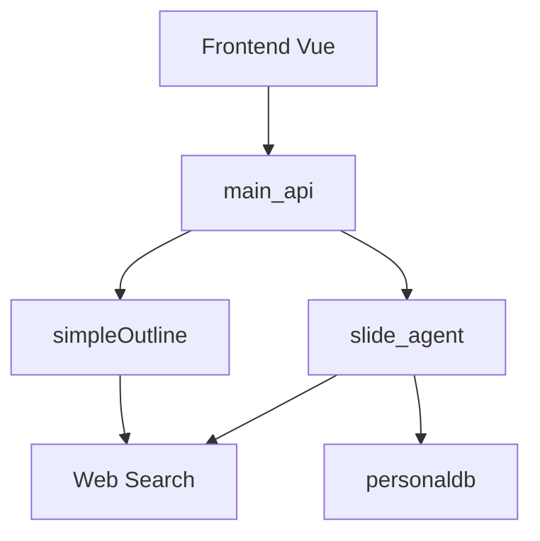

# johnson7788/TrainPPTAgent

> Générateur de présentations par IA : de l'idée au plan, puis page par page, avec recherche web.

## Le problème
Écrire un plan puis le contenu de chaque diapositive à partir de sources demande des heures de recherche manuelle.

## Ce que ça fait vraiment
- Front Vue.js, Vite et TypeScript ; back Python (FastAPI) avec A2A, ADK et MCP.
- Génère un plan Markdown, puis le contenu page par page en flux, selon un modèle choisi.
- Peut chercher sur le web, chercher des images ou interroger une base de connaissances de fichiers déposés.
- Un entraînement par GRPO est annoncé, son code vit dans un autre dépôt.

## Comment c'est branché


## Essayer
```bash
cp env_template.txt .env
python start.py
cd backend
pip install -r requirements.txt
python start_backend.py
cd frontend
npm install
npm run dev
docker compose up
```

## Coût et pièges
Clés d'API de modèle (commerciaux ou locaux) à ta charge ; plusieurs `.env`, un par service. Le front reprend PPTist, sous AGPL-3 : le back est annoncé libre, le front non.

## Ce que ce n'est pas
Pas une application hébergée. Le README en chinois couvre peu l'évaluation de qualité ; les cases de la liste restent à faire. Les modèles RL ne sont pas dans ce dépôt.

## Alternatives
Aucune alternative nommée dans le README, hormis PPTist pour le front.

## Pour toi
À surveiller : exemple utile de pipeline d'agents en plan et pages avec RL, à lire pour l'architecture plus qu'à déployer.

