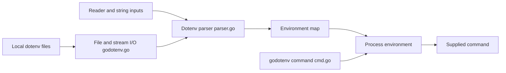

# joho/godotenv

> Go port of dotenv: loads the variables of a `.env` file into the environment.

## The problem
Setting environment variables by hand on every dev machine or CI is tedious and error-prone.

## What it actually does
`godotenv.Load()` reads `.env` (or several files) and injects the variables without overwriting existing ones; `Overload()` to force.
Parser handling comments, `export`, quotes, YAML style, variable substitution.
Reading from a file, an `io.Reader` or a string; writing/marshaling to `.env`.
Command `godotenv -f file command` to run a process with that environment.

## How it is wired


## Trying it
```bash
go get github.com/joho/godotenv
go install github.com/joho/godotenv/cmd/godotenv@latest
godotenv -f /some/path/to/.env some_command with some args
```

## Cost and gotchas
Free, Go stdlib only. The binary is not guaranteed on Windows.

## What it is not
Not a secrets manager: `.env` files remain in plain text. Key-name compatibility is aligned with Node, not Ruby.

## Alternatives
None named (the project presents itself as a port of Ruby's dotenv).

## For you
To ignore: a mature and stable Go building block, but your Python ecosystem already has python-dotenv for the same purpose.
