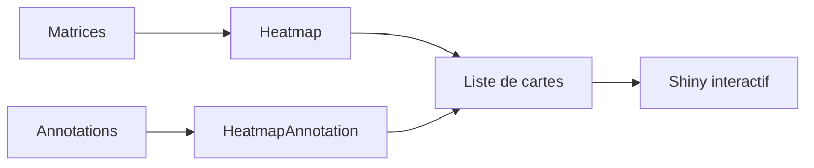

# jokergoo/ComplexHeatmap

> R package for assembling several annotated heatmaps, useful in genomics and data visualization.

## The problem
A simple heatmap is not enough to cross several data sources with their annotations.

## What it actually does
- One or more heatmaps side by side, with row and column annotations.
- Combined with the `+` operator; supports many annotation graphics.
- The InteractiveComplexHeatmap package exports to a Shiny application.
- Examples: methylation, single-cell RNA, OncoPrint, UpSet, 3D map.

## How it is wired


## Trying it
```r
if (!requireNamespace("BiocManager", quietly=TRUE))
    install.packages("BiocManager")
BiocManager::install("ComplexHeatmap")
Heatmap(mat, ...)
```

## Cost and gotchas
Free. R required, not Python (the plan's "Python version" value is the closest one; it is in fact an R version). License present but not identified. 232 open issues.

## What it is not
Not a Python tool. A single person maintains it.

## Alternatives
pheatmap (cited: a post explains how to migrate from pheatmap to ComplexHeatmap).

## For you
Worth watching if you analyze matrices in R (biology, correlations); useless if you stay on Python.
