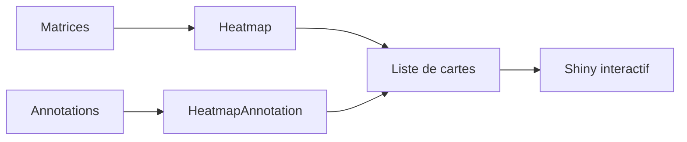

# jokergoo/ComplexHeatmap

> Package R pour assembler plusieurs cartes de chaleur annotées, utile en génomique et en visualisation de données.

## Le problème
Un graphique de chaleur simple ne suffit pas pour croiser plusieurs sources de données avec leurs annotations.

## Ce que ça fait vraiment
- Une ou plusieurs cartes de chaleur côte à côte, avec annotations en lignes et colonnes.
- Se combine avec l'opérateur `+` ; supporte de nombreux graphiques d'annotation.
- Le package InteractiveComplexHeatmap exporte vers une application Shiny.
- Exemples : méthylation, ARN en cellule unique, OncoPrint, UpSet, carte 3D.

## Comment c'est branché


## Essayer
```r
if (!requireNamespace("BiocManager", quietly=TRUE))
    install.packages("BiocManager")
BiocManager::install("ComplexHeatmap")
Heatmap(mat, ...)
```

## Coût et pièges
Gratuit. R requis, pas Python (la valeur « version de Python » du plan est la plus proche, il s'agit en fait d'une version de R). Licence présente mais non identifiée. 232 issues ouvertes.

## Ce que ce n'est pas
Pas un outil Python. Une seule personne le maintient.

## Alternatives
pheatmap (cité : un billet explique comment migrer de pheatmap vers ComplexHeatmap).

## Pour toi
À surveiller si tu analyses des matrices en R (biologie, corrélations) ; inutile si tu restes sur Python.

