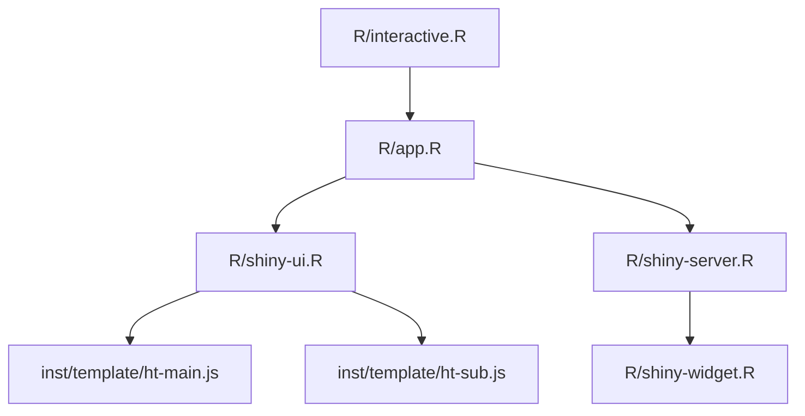

# jokergoo/InteractiveComplexHeatmap

> R package that turns a static ComplexHeatmap heatmap into an interactive Shiny application.

## The problem
A static heatmap does not let you select cells or explore a subset.

## What it actually does
`htShiny(ht)` creates a Shiny application with selection by hover, click, double click or area, and a sub-heatmap. Functions (`InteractiveComplexHeatmapOutput`, `makeInteractiveComplexHeatmap`, `Modal`, `Widget`) are used to embed the widget in an application. Also works with `pheatmap`, `heatmap.2` and in R Markdown.

## How it is wired
Diagram based on the code diagram.



## Trying it
```bash
# Dans R :
# BiocManager::install("InteractiveComplexHeatmap")
# htShiny(ht_list)
# htShinyExample()
```

## Cost and gotchas
Free. Requires R, Bioconductor and ComplexHeatmap. License not identified by GitHub.

## What it is not
Not a new heatmap tool: it builds on ComplexHeatmap and only works in R/Shiny.

## Alternatives
None cited in the README.

## For you
Keep an eye on it: useful if you do exploratory analysis in R (genomics, matrices), otherwise irrelevant.
