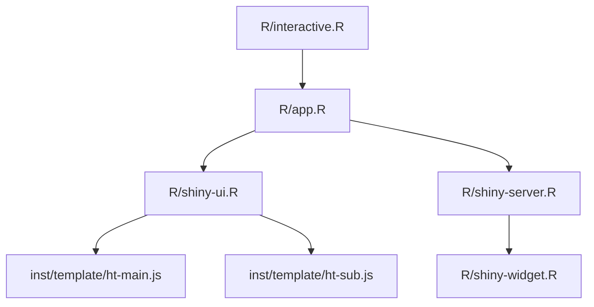

# jokergoo/InteractiveComplexHeatmap

> Paquet R qui transforme une heatmap ComplexHeatmap statique en application Shiny interactive.

## Le problème
Une heatmap statique ne permet ni de sélectionner des cellules ni d'explorer un sous-ensemble.

## Ce que ça fait vraiment
`htShiny(ht)` crée une application Shiny avec sélection par survol, clic, double clic ou zone, et sous-heatmap. Des fonctions (`InteractiveComplexHeatmapOutput`, `makeInteractiveComplexHeatmap`, `Modal`, `Widget`) servent à intégrer le widget dans une application. Fonctionne aussi avec `pheatmap`, `heatmap.2` et dans R Markdown.

## Comment c'est branché
Schéma d'après le diagramme du code.



## Essayer
```bash
# Dans R :
# BiocManager::install("InteractiveComplexHeatmap")
# htShiny(ht_list)
# htShinyExample()
```

## Coût et pièges
Gratuit. R, Bioconductor et ComplexHeatmap nécessaires. Licence non identifiée par GitHub.

## Ce que ce n'est pas
Pas un nouvel outil de heatmap : il s'appuie sur ComplexHeatmap et ne fonctionne qu'en R/Shiny.

## Alternatives
Aucune citée dans le README.

## Pour toi
Surveiller : utile si tu fais de l'analyse exploratoire en R (génomique, matrices), sinon sans objet.

