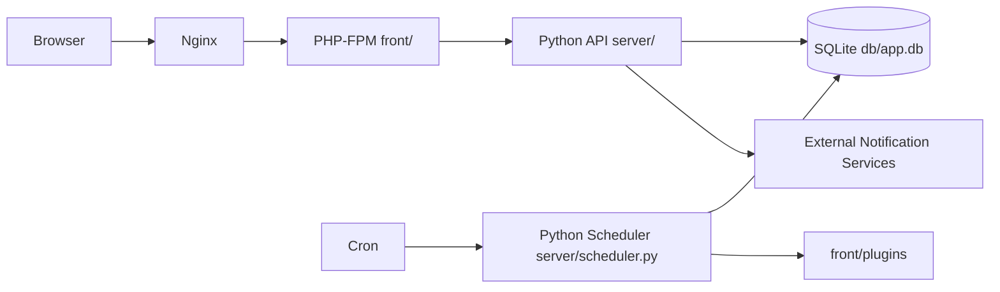

# jokob-sk/NetAlertX

> Self-hosted application that inventories the devices on a local network and alerts on arrivals or changes.

## The problem
Without a continuous inventory, you do not know which devices are plugged into the network, which are new or unauthorized, and which IP they occupy.

## What it actually does
A single container runs Nginx, PHP-FPM, cron and a Python server. Plugins (arp-scan, Pi-hole import, DHCP, UniFi, SNMP) feed a SQLite database. The web interface lists devices, their presence and their changes. Notifications go out via Apprise, Pushover, NTFY or webhooks; workflows classify or clean up devices; "Sync Nodes" send the inventory of several sites up to a hub.

## How it is wired


## Trying it
```bash
docker run -d \
  --network=host \
  --restart unless-stopped \
  --cap-add=NET_RAW \
  --cap-add=NET_ADMIN \
  --cap-add=NET_BIND_SERVICE \
  -v /local_data_dir:/data \
  -v /etc/localtime:/etc/localtime:ro \
  --tmpfs /tmp:uid=20211,gid=20211,mode=1700 \
  -e PORT=20211 \
  -e APP_CONF_OVERRIDE='{"GRAPHQL_PORT":"20214"}' \
  ghcr.io/netalertx/netalertx:latest
```

## Cost and gotchas
Free; requires Docker in host network mode and extended network capabilities (NET_RAW, NET_ADMIN). The data folder must contain `config` and `db`, to be backed up. The README flags a recent change to docker-compose: read the migration guide.

## What it is not
Neither a full infrastructure monitoring system (Zabbix, Nagios) nor a SIEM. Network discovery should only be run on networks you are responsible for. There is no native strong authentication: the README recommends a reverse proxy with authentication.

## Alternatives
- NetBox: the reference for network source of truth and IPAM.
- Zabbix or Nagios: broader infrastructure monitoring.
- Fing: commercial, proprietary scanner.

## For you
Worth watching: useful for a homelab or a fleet to inventory, but outside the data/AI/MLOps core, and carried by a single maintainer under GPL-3.0.
