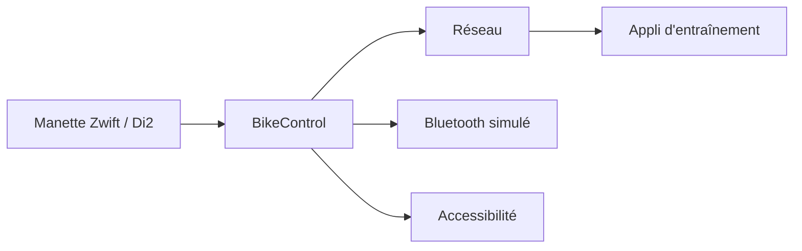

# jonasbark/swiftcontrol

> BikeControl application that connects Zwift or Shimano Di2 controllers to indoor-trainer training apps.

## The problem
Connected bike controllers do not all control every training app.

## What it actually does
Connects to the controllers, then sends commands to the app via the network, simulated Bluetooth, accessibility or the OpenBikeControl protocol. Handles virtual gear shifts, steering, music, screenshots. On Android, iOS, macOS and Windows.

## How it is wired
Simplified diagram based on the sheet, no diagram provided.


## Trying it
```bash
git clone https://github.com/OpenBikeControl/bikecontrol.git
cd bikecontrol
flutter pub get
flutter build apk --debug
```

## Cost and gotchas
Trial period then license. Flutter is required to build. The private `prop` submodule is not public: the free build has inert emulation.

## What it is not
It is not fully open: the indoor-trainer emulation is closed. Unrelated to data or AI.

## Alternatives
No alternative named in the README.

## For you
Ignore: a cycling app unrelated to a data / AI / MLOps profile, with a closed functional core.
