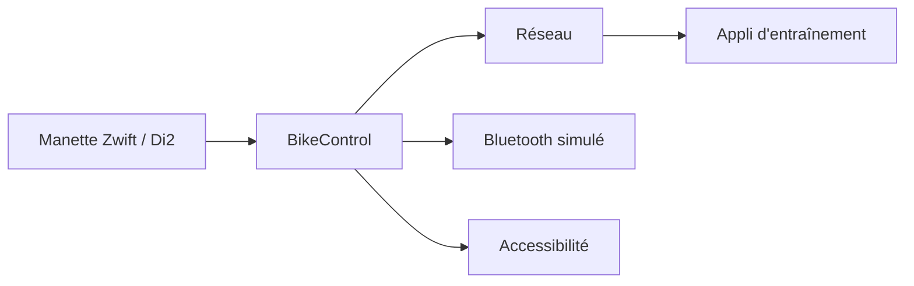

# jonasbark/swiftcontrol

> Application BikeControl qui relie manettes Zwift ou Shimano Di2 aux applications d'entraînement sur home trainer.

## Le problème
Les manettes de vélo connectées ne pilotent pas toutes les applications d'entraînement.

## Ce que ça fait vraiment
Se connecte aux manettes, puis envoie des commandes à l'application via le réseau, un Bluetooth simulé, l'accessibilité ou le protocole OpenBikeControl. Gère changements de vitesse virtuels, direction, musique, captures. Sur Android, iOS, macOS et Windows.

## Comment c'est branché
Schéma simplifié d'après la fiche, sans diagramme fourni.


## Essayer
```bash
git clone https://github.com/OpenBikeControl/bikecontrol.git
cd bikecontrol
flutter pub get
flutter build apk --debug
```

## Coût et pièges
Période d'essai puis licence. Flutter est requis pour compiler. Le sous-module privé `prop` n'est pas public : la build libre a l'émulation inerte.

## Ce que ce n'est pas
Ce n'est pas entièrement ouvert : l'émulation de home trainer est fermée. Sans rapport avec la data ou l'IA.

## Alternatives
Aucune alternative nommée dans le README.

## Pour toi
À ignorer : application de cyclisme sans lien avec un profil data / IA / MLOps, et cœur fonctionnel fermé.

