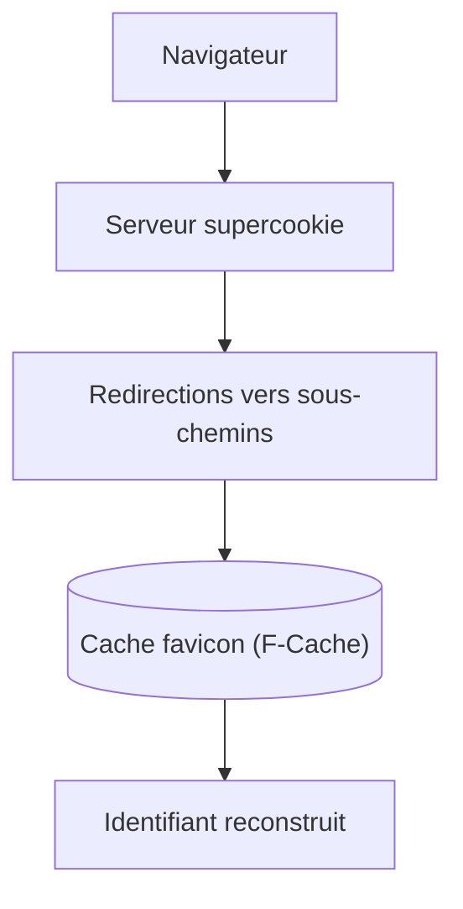

# jonasstrehle/supercookie

> Demonstration of browser tracking through the favicon cache, for educational purposes.

## The problem
The usual defenses (private mode, VPN, cookie deletion) do not block this tracking vector.

## What it actually does
The server serves favicons on a series of subpaths; the present or absent state in the browser's favicon cache forms an identifier, read back on reload. It distinguishes 2^N users for N redirects. The author states an educational use.

## How it is wired
Simplified diagram based on the fiche, no diagram provided.


## Trying it
```bash
git clone https://github.com/jonasstrehle/supercookie
cd supercookie/server
docker-compose up
```

## Cost and gotchas
Free. The `server/.env` file must be edited (HOST_MAIN, PORT_MAIN, HOST_DEMO, PORT_DEMO). Browser results are dated (Chrome 111, Firefox 86). Repository archived.

## What it is not
Not a defense: it is the demonstration of the attack. The compatibility tables no longer hold for recent browsers.

## Alternatives
No alternative named in the README.

## For you
Watch: useful for raising awareness of web privacy or understanding fingerprinting, but archived and dated.
