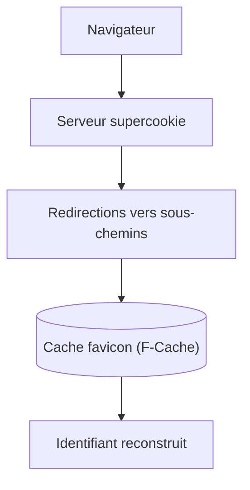

# jonasstrehle/supercookie

> Démonstration de pistage de navigateurs par le cache des favicons, à des fins pédagogiques.

## Le problème
Les défenses habituelles (mode privé, VPN, suppression des cookies) ne bloquent pas ce vecteur de suivi.

## Ce que ça fait vraiment
Le serveur sert des favicons sur une série de sous-chemins ; l'état présent ou absent dans le cache de favicons du navigateur forme un identifiant, relu au rechargement. Il distingue 2^N utilisateurs pour N redirections. L'auteur précise un usage éducatif.

## Comment c'est branché
Schéma simplifié d'après la fiche, sans diagramme fourni.


## Essayer
```bash
git clone https://github.com/jonasstrehle/supercookie
cd supercookie/server
docker-compose up
```

## Coût et pièges
Gratuit. Le fichier `server/.env` doit être édité (HOST_MAIN, PORT_MAIN, HOST_DEMO, PORT_DEMO). Résultats de navigateurs datés (Chrome 111, Firefox 86). Dépôt archivé.

## Ce que ce n'est pas
Pas une défense : c'est la démonstration de l'attaque. Les tableaux de compatibilité ne valent plus pour les navigateurs récents.

## Alternatives
Aucune alternative nommée dans le README.

## Pour toi
Surveiller : utile pour sensibiliser à la vie privée web ou comprendre le fingerprinting, mais archivé et daté.

