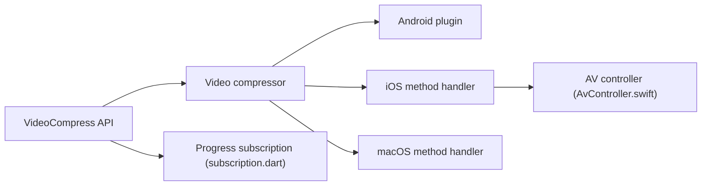

# jonataslaw/VideoCompress

> Flutter plugin that compresses videos and generates thumbnails using native Android, iOS and macOS code.

## The problem
Compressing a video into a format that plays everywhere, without bundling a heavy, GNU-licensed FFmpeg.

## What it actually does
Calls each platform's native code (AVFoundation on Apple) from Dart: compression to MP4/AAC, thumbnails in memory or as files, media information, progress tracking, cache cleanup. Cancellation on Android and trimming are listed as "TODO".

## How it is wired


## Trying it
```bash
pub get
```
```dart
MediaInfo mediaInfo = await VideoCompress.compressVideo(path, quality: VideoQuality.DefaultQuality, deleteOrigin: false);
```

## Cost and gotchas
Free. Dependency `video_compress: ^3.1.0` in pubspec.yaml. Desktop: macOS only. 208 open issues, last push on 2025-02-13.

## What it is not
Not a universal transcoder: a single output format, MP4/AAC. No Windows or Linux.

## Alternatives
flutter_video_compress (rurico), which it draws inspiration from, based on FFmpeg.

## For you
Ignore: a Flutter mobile plugin unrelated to your field, and little maintained for over a year.
