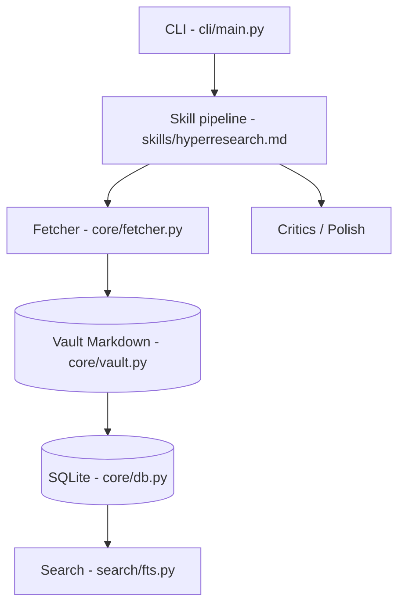

# jordan-gibbs/hyperresearch

> Deep-research skill for Claude Code and Codex, with a local vault of reusable sources.

## The problem
Deep-research tools return a report and then throw away everything they read; citations remain poorly verified.

## What it actually does
A 16-step pipeline (decomposition, broad sweep, locale analysis, adversarial critiques, surgical patching, citation verification) produces a report. Each source is stored as Markdown with a rebuildable SQLite index. Guardrails block citations of retracted sources and citations that do not exist in the vault. The README claims first place on the DRACO benchmark, which is not verified here. MCP server and local web interface included.

## How it is wired


## Trying it
```bash
pip install hyperresearch
hyperresearch install
hyperresearch install . --target codex
hyperresearch profile use premier
hyperresearch run status -j
```
Then `/hyperresearch <question>` in Claude Code.

## Cost and gotchas
Python 3.11 to 3.14. A "full" run takes about 1.5 to 2.5 hours, "premier" 3 to 5 hours, with many sub-agents (Opus and Sonnet): the token cost is high. `run init --budget 50` caps spending. Under Codex, tool locks are only instructions.

## What it is not
Not a web search engine. The "dissertation" mode is experimental: its length targets are not wired up yet (issue #103).

## Alternatives
No alternative named in the README.

## For you
Interesting for monitoring or tooled literature reviews; worth watching after a measured trial, since the token cost can climb quickly.
