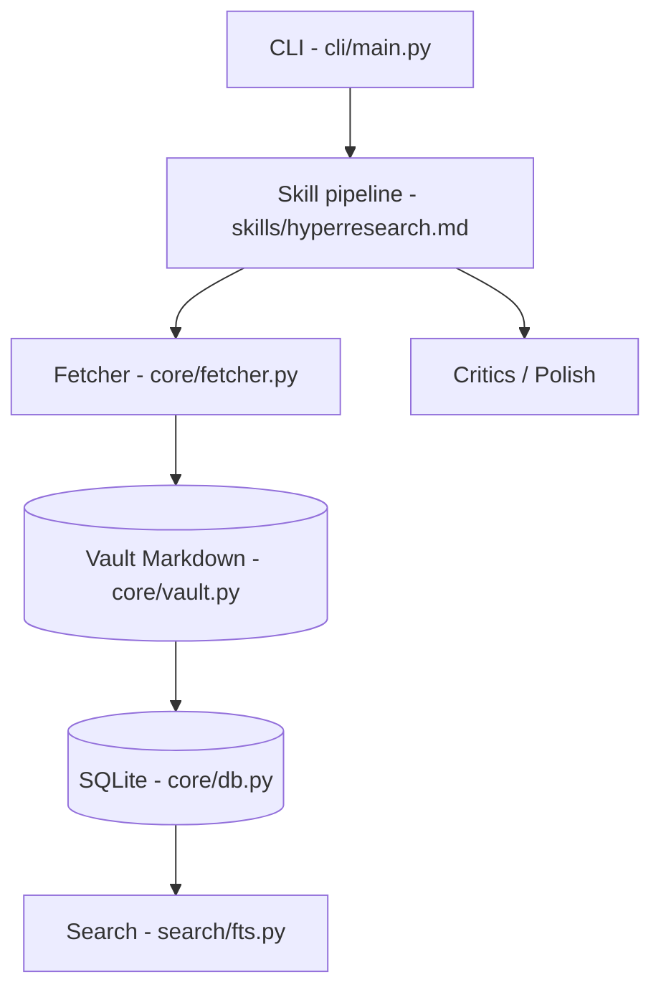

# jordan-gibbs/hyperresearch

> Skill de recherche approfondie pour Claude Code et Codex, avec un coffre local de sources réutilisables.

## Le problème
Les outils de recherche approfondie rendent un rapport puis jettent tout ce qui a été lu ; les citations restent peu vérifiées.

## Ce que ça fait vraiment
Un pipeline en 16 étapes (décomposition, balayage large, analyse de lieux, critiques adverses, patch chirurgical, vérification des citations) produit un rapport. Chaque source est stockée en Markdown avec un index SQLite reconstructible. Des garde-fous bloquent les citations de sources rétractées et les citations qui n'existent pas dans le coffre. Le README revendique la première place sur le benchmark DRACO, sans que ce soit vérifié ici. Serveur MCP et interface web locale inclus.

## Comment c'est branché


## Essayer
```bash
pip install hyperresearch
hyperresearch install
hyperresearch install . --target codex
hyperresearch profile use premier
hyperresearch run status -j
```
Puis `/hyperresearch <question>` dans Claude Code.

## Coût et pièges
Python 3.11 à 3.14. Une exécution « full » dure environ 1,5 à 2,5 h, « premier » 3 à 5 h, avec de nombreux sous-agents (Opus et Sonnet) : le coût en tokens est élevé. `run init --budget 50` plafonne la dépense. Sous Codex, les verrous d'outils ne sont que des instructions.

## Ce que ce n'est pas
Pas un moteur de recherche web. Le mode « dissertation » est expérimental : ses objectifs de longueur ne sont pas encore câblés (issue #103).

## Alternatives
Aucune alternative nommée dans le README.

## Pour toi
Intéressant pour de la veille ou des revues de littérature outillées ; à surveiller après un essai mesuré, car le coût en tokens peut vite grimper.

