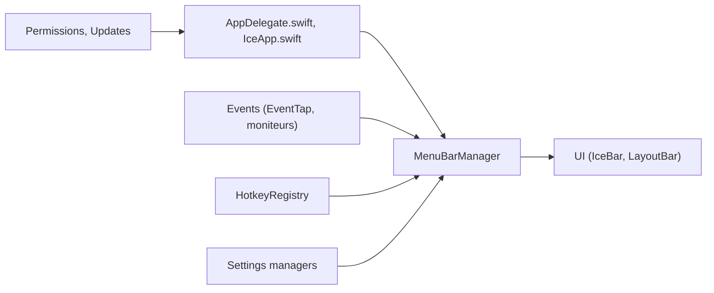

# jordanbaird/Ice

> macOS application to hide, rearrange and customize menu bar icons.

## The problem
The macOS menu bar fills up with icons, and the MacBook notch hides some of them.

## What it actually does
Hides icons in a collapsible or always-hidden section, reveals them on hover, click or scroll, or in a separate bar below the menu bar. Drag-and-drop rearranging, icon search, spacing, tint, shadow, border and custom shapes, keyboard shortcuts, launch at login and automatic updates. Several features remain opt-in (profiles, groups).

## How it is wired


## Trying it
```bash
brew install --cask jordanbaird-ice
```
Manual installation: download Ice.zip from the latest release and place it in Applications.

## Cost and gotchas
Free. Last push on 2025-09-20, more than a year ago, while the README speaks of active development. GPL-3.0 license. The code indicates macOS 14 or later.

## What it is not
Not a productivity tool in the broad sense: only the macOS menu bar. Some announced features are not implemented.

## Alternatives
No alternative cited in the README.

## For you
To ignore: macOS utility unrelated to data/AI/MLOps, and no commit for more than a year.
