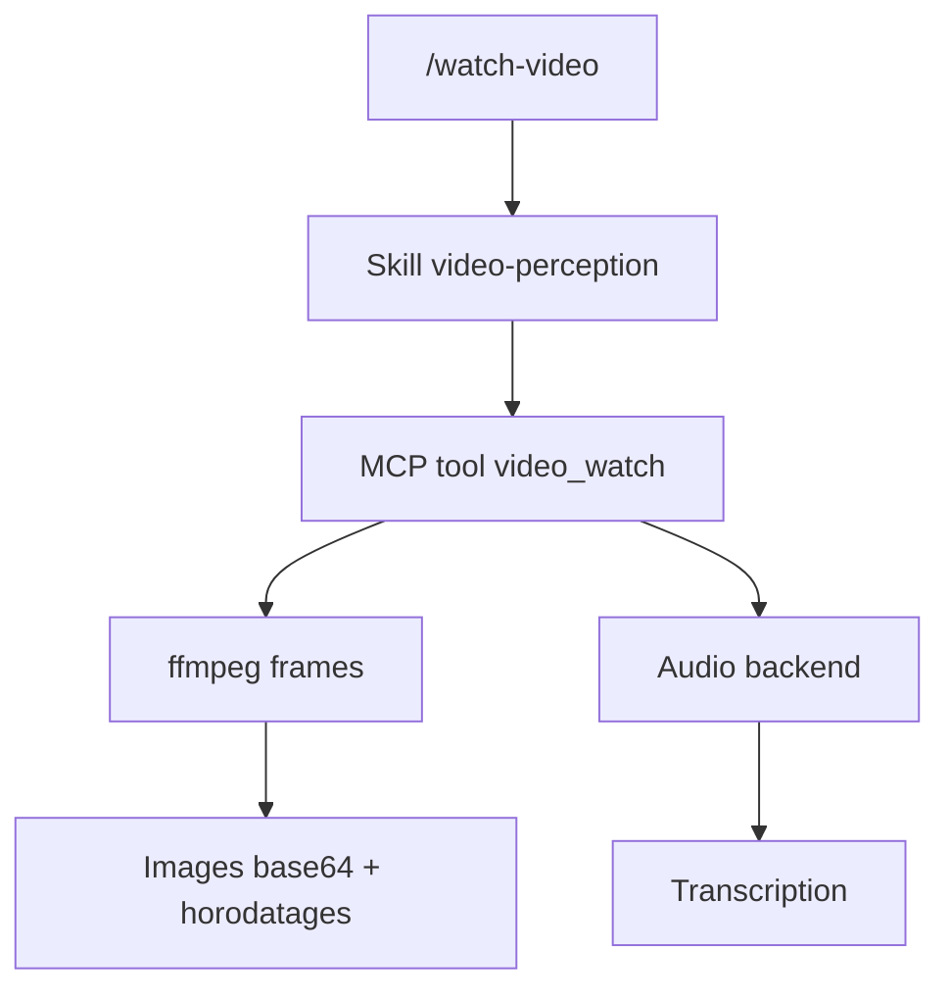

# jordanrendric/claude-video-vision

> Claude Code plugin that extracts frames from a video and the audio transcript so that Claude can understand it.

## The problem
Claude does not read a video directly: without frames or a transcript, it can neither summarize it nor answer a question about it.

## What it actually does
The MCP server (Node) extracts frames with ffmpeg and processes the audio in parallel with Gemini, local Whisper or the OpenAI API. Claude receives the frames in base64 with their timestamps and the transcript. For a YouTube URL, `yt-dlp` downloads the video and subtitles are used first. Six MCP tools and two commands (`/watch-video`, `/setup-video-vision`) are provided.

## How it is wired
Based on the README's architecture.



## Trying it
```
/plugin marketplace add https://github.com/jordanrendric/claude-video-vision
/plugin install claude-video-vision
/claude-video-vision:setup-video-vision
/watch-video path/to/video.mp4 "what language is used in this tutorial?"
```

## Cost and gotchas
Free locally with Whisper; the Gemini API has a free tier (1500 requests per day) and OpenAI is paid. Node 24 and ffmpeg required, `yt-dlp` for YouTube. On Windows, an old `npx` makes the server fail.

## What it is not
Not an interpretation model: it is a perception layer, Claude interprets by itself. It does not summarize without calling Claude.

## Alternatives
No alternative named in the README.

## For you
Adopt: a small plugin useful for having Claude Code analyze videos and tutorials, with a fully local, free mode.
