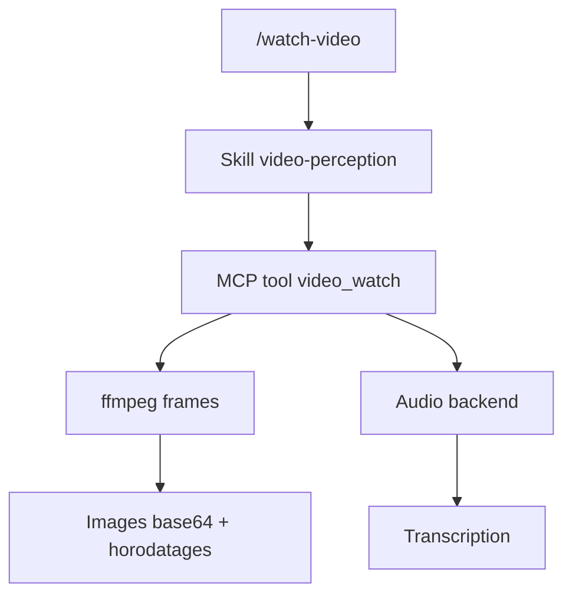

# jordanrendric/claude-video-vision

> Plugin Claude Code qui extrait des images d'une vidéo et la transcription audio pour que Claude la comprenne.

## Le problème
Claude ne lit pas directement une vidéo : sans images ni transcription, il ne peut ni la résumer ni répondre à une question dessus.

## Ce que ça fait vraiment
Le serveur MCP (Node) extrait des images avec ffmpeg et traite l'audio en parallèle avec Gemini, Whisper local ou l'API OpenAI. Claude reçoit les images en base64 avec leurs horodatages et la transcription. Pour une URL YouTube, `yt-dlp` télécharge la vidéo et les sous-titres sont utilisés en priorité. Six outils MCP et deux commandes (`/watch-video`, `/setup-video-vision`) sont fournis.

## Comment c'est branché
D'après l'architecture du README.



## Essayer
```
/plugin marketplace add https://github.com/jordanrendric/claude-video-vision
/plugin install claude-video-vision
/claude-video-vision:setup-video-vision
/watch-video path/to/video.mp4 "what language is used in this tutorial?"
```

## Coût et pièges
Gratuit en local avec Whisper ; l'API Gemini a un palier gratuit (1500 requêtes par jour) et OpenAI est payant. Node 24 et ffmpeg requis, `yt-dlp` pour YouTube. Sous Windows, un `npx` ancien fait échouer le serveur.

## Ce que ce n'est pas
Pas un modèle d'interprétation : c'est une couche de perception, Claude interprète lui-même. Il ne résume pas sans appeler Claude.

## Alternatives
Aucune alternative nommée dans le README.

## Pour toi
À adopter : petit plugin utile pour faire analyser des vidéos et tutoriels par Claude Code, avec un mode entièrement local sans frais.

