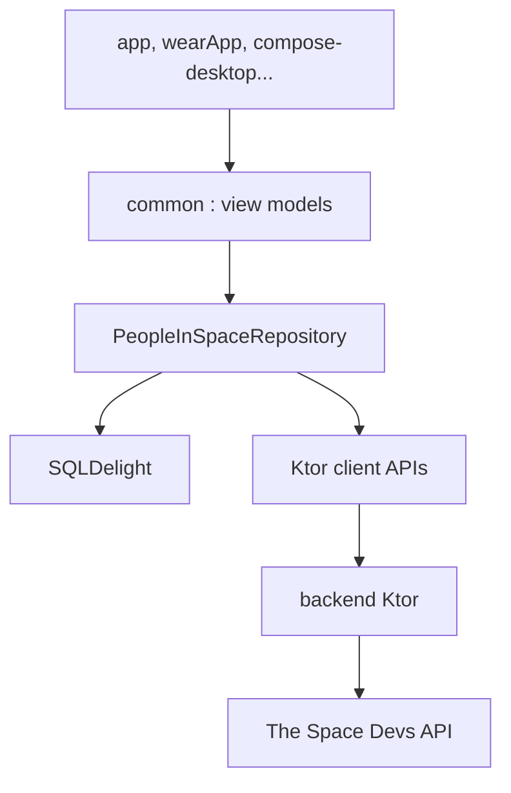

# joreilly/PeopleInSpace

> Kotlin Multiplatform sample project listing the astronauts in orbit, with mobile, web, desktop clients and an MCP server.

## The problem
Show concretely how to share the same Kotlin code across Android, iOS, Wear OS, desktop, web and Windows.

## What it actually does
A `common` module (view models, offline repository on SQLDelight, Ktor clients) serves all clients. A small Ktor backend relays the The Space Devs API; the ISS position comes from wheretheiss.at. An `mcp-server` module exposes the list of astronauts to Claude Desktop.

## How it is wired


## Trying it
```bash
./gradlew :app:installDebug
./gradlew :compose-desktop:run
./gradlew :backend:run
./gradlew :common:jvmTest
```

## Cost and gotchas
JDK 17 required, Android Studio for Android/Wear, Xcode for iOS. Backend deployment is tested on Google App Engine.

## What it is not
Not a product: a deliberately minimal example. The README points to KaMPKit (Touchlab) to go further.

## Alternatives
KaMPKit by Touchlab, to go beyond the minimal level; Confetti or GalwayBus by the same author, as other examples.

## For you
Ignore: an educational Kotlin Multiplatform example, unrelated to data, AI or MLOps work.
