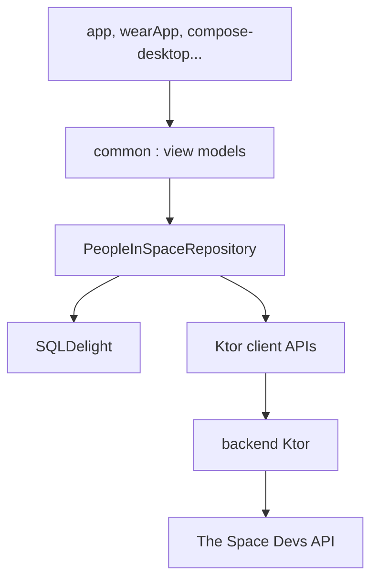

# joreilly/PeopleInSpace

> Projet d'exemple Kotlin Multiplatform listant les astronautes en orbite, avec clients mobile, web, bureau et serveur MCP.

## Le problème
Montrer concrètement comment partager un même code Kotlin entre Android, iOS, Wear OS, bureau, web et Windows.

## Ce que ça fait vraiment
Un module `common` (vues-modèles, dépôt hors ligne sur SQLDelight, clients Ktor) sert tous les clients. Un petit backend Ktor relaie l'API The Space Devs ; la position de l'ISS vient de wheretheiss.at. Un module `mcp-server` expose la liste des astronautes à Claude Desktop.

## Comment c'est branché


## Essayer
```bash
./gradlew :app:installDebug
./gradlew :compose-desktop:run
./gradlew :backend:run
./gradlew :common:jvmTest
```

## Coût et pièges
JDK 17 requis, Android Studio pour Android/Wear, Xcode pour iOS. Le déploiement du backend est testé sur Google App Engine.

## Ce que ce n'est pas
Pas un produit : un exemple volontairement minimal. Le README renvoie vers KaMPKit (Touchlab) pour aller plus loin.

## Alternatives
KaMPKit de Touchlab, pour dépasser le niveau minimal ; Confetti ou GalwayBus du même auteur, comme autres exemples.

## Pour toi
À ignorer : exemple pédagogique de Kotlin Multiplatform, sans lien avec un travail data, IA ou MLOps.

