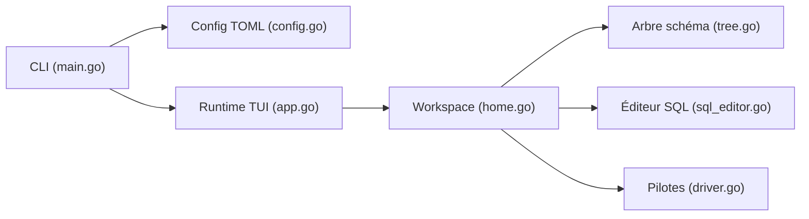

# jorgerojas26/lazysql

> Terminal SQL client inspired by Lazygit, for developers who live in the shell.

## The problem
Graphical SQL clients are heavy, and the terminal lacks a Lazygit-like tool for browsing tables and queries.

## What it actually does
A TUI in Go with Vim keybindings, multiple connections, tabs, SQL editor, schema tree, editable tables (insert, update, delete pending confirmation), WHERE filters, query history, JSON viewer, CSV export. Drivers: PostgreSQL, MySQL, SQLite, SQL Server, ClickHouse, Oracle (example URL). Read-only mode, pre-commands (SSH tunnel, port-forward) and environment variables in TOML configuration.

## How it is wired


## Trying it
```bash
brew install lazysql
go install github.com/jorgerojas26/lazysql@latest
lazysql --read-only [connection_url]
```

## Cost and gotchas
Free. The README states an ALPHA stage and known bugs. The password in the URL should come from `${env:VAR}` rather than being written in plain text.

## What it is not
No table creation from the interface (go through the SQL editor). Not an administration or migration tool.

## Alternatives
Mitzasql and Gobang (listed in the README).

## For you
Worth trying to quickly explore warehouses and feature databases from a terminal; enable read-only mode on production databases.
