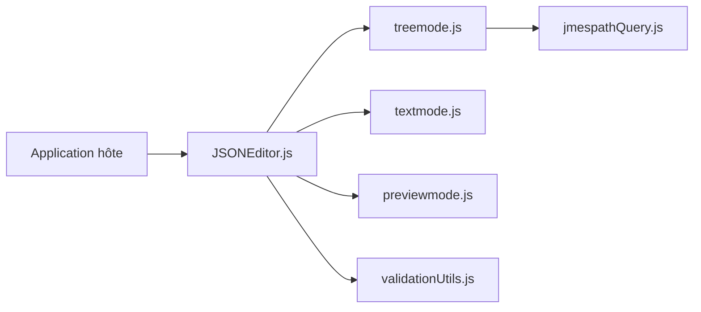

# josdejong/jsoneditor

> Web component to view, edit, format and validate JSON, in tree, code, text and preview modes.

## The problem
Editing JSON by hand in a web interface, with validation, is painful without a dedicated component.

## What it actually does
Tree mode (add, move, sort, undo/redo, search, JMESPath queries), code mode (Ace), text mode, preview mode (documents up to 500 MiB). JSON repair and schema validation through ajv. The README announces a successor, svelte-jsoneditor, which is not a strict replacement.

## How it is wired


## Trying it
```bash
npm install jsoneditor
npm run build
npm test
```

## Cost and gotchas
Free. Tested browsers: Chrome, Firefox, Safari, Edge.

## What it is not
Not a standalone editor: it is a component to integrate. The project is the origin of jsoneditoronline.org.

## Alternatives
- svelte-jsoneditor: successor cited in the README.

## For you
Ignore as a priority: useful only if you build a web interface that edits JSON configs or schemas.
