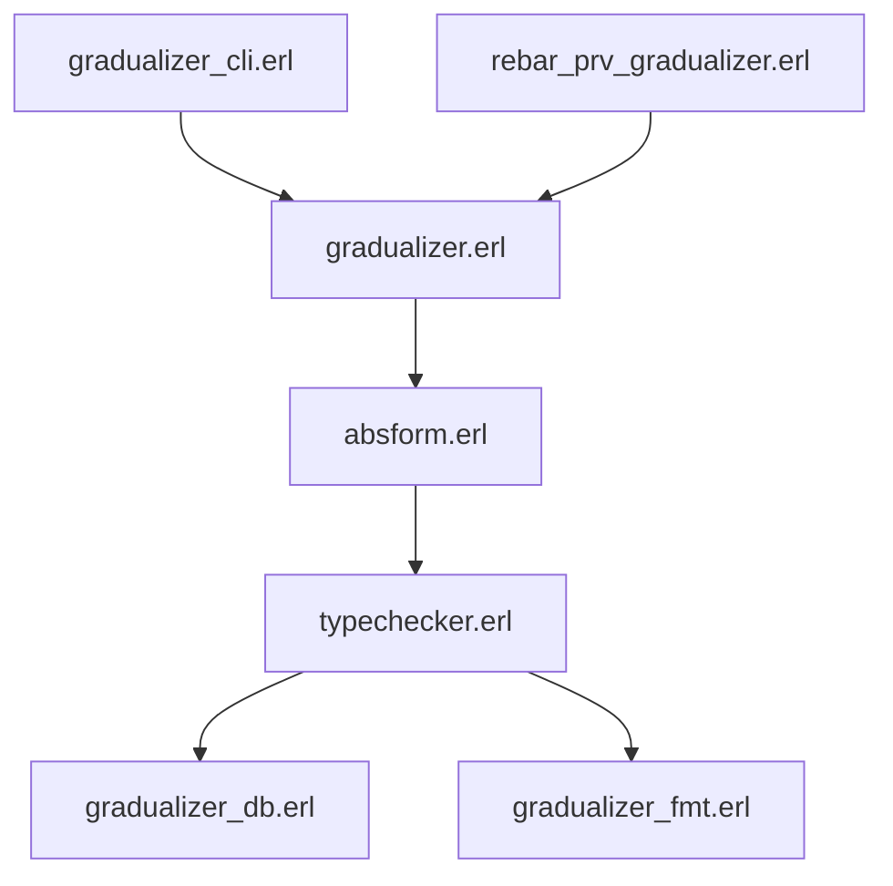

# josefs/Gradualizer

> Static, gradual type checker for Erlang, to be adopted progressively.

## The problem
Erlang does not catch at compile time the type errors that its specs could reveal.

## What it actually does
Reads the abstract code (`absform.erl`) and checks it against existing specs with `typechecker.erl`, backed by `typelib`, `constraints` and the `gradualizer_db` spec database fed by the OTP prelude. Without a spec, no check; the more specs there are, the stricter it gets. Usable via escript, rebar3, Mix (Gradient) or shell.

## How it is wired


## Trying it
```bash
make escript
bin/gradualizer --help
make shell
```

## Cost and gotchas
Free. Real requirement: Erlang/OTP 21 or later. The README speaks of a version "close to beta"; 104 open issues.

## What it is not
It is not a complete checker: known cases fail (`test/known_problems/`).

## Alternatives
- Gradient (esl/gradient): the Elixir frontend of Gradualizer.

## For you
Ignore: useful to Erlang or Elixir teams, of no relevance to a data / AI / MLOps profile.
