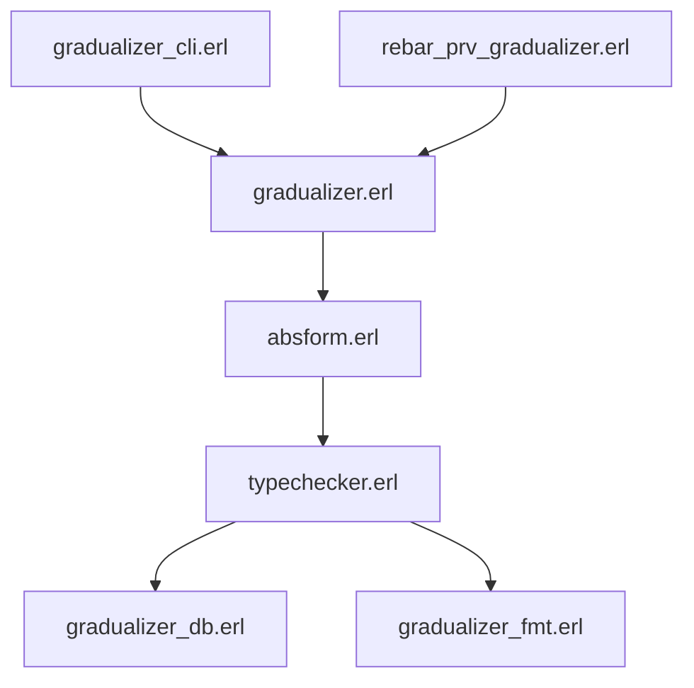

# josefs/Gradualizer

> Vérificateur de types statique et graduel pour Erlang, à adopter progressivement.

## Le problème
Erlang n'attrape pas à la compilation les erreurs de type que ses specs pourraient révéler.

## Ce que ça fait vraiment
Lit le code abstrait (`absform.erl`) et le vérifie contre les specs existantes avec `typechecker.erl`, appuyé sur `typelib`, `constraints` et la base de specs `gradualizer_db` alimentée par le prelude OTP. Sans spec, aucun contrôle ; plus il y en a, plus c'est strict. Utilisable via escript, rebar3, Mix (Gradient) ou shell.

## Comment c'est branché


## Essayer
```bash
make escript
bin/gradualizer --help
make shell
```

## Coût et pièges
Gratuit. Besoin réel : Erlang/OTP 21 ou plus. Le README parle d'une version « proche d'une bêta » ; 104 issues ouvertes.

## Ce que ce n'est pas
Ce n'est pas un vérificateur complet : des cas connus échouent (`test/known_problems/`).

## Alternatives
- Gradient (esl/gradient) : le frontend Elixir de Gradualizer.

## Pour toi
À ignorer : utile aux équipes Erlang ou Elixir, sans portée pour un profil data / IA / MLOps.

