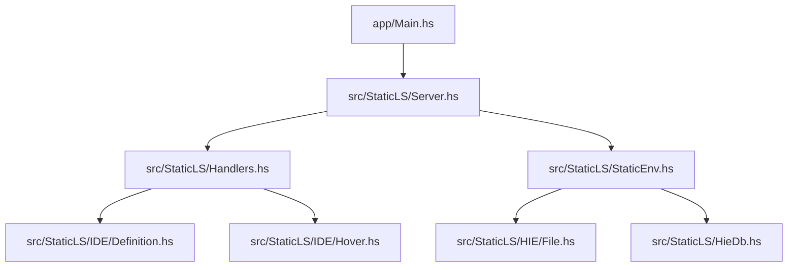

# josephsumabat/static-ls

> Lightweight Haskell language server that reads pre-generated HIE files, for large projects.

## The problem
haskell-language-server uses too much memory when recompiling on very large projects.

## What it actually does
Main starts the server, which loads the static environment (HIE files and the hiedb database) and then answers LSP requests: definition, hover, references, rename, symbols, code actions, autocompletion. It generates nothing itself: the user compiles with the right GHC flags and indexes with hiedb.

## How it is wired


## Trying it
```bash
cabal install
hiedb -D .hiedb index .hiefiles --src-base-dir .
```

## Cost and gotchas
Build from source with the same GHC version as the project (9.4.4 and 9.6.1 explicitly supported). You must re-index after every change.

## What it is not
Not a general replacement for haskell-language-server: the README recommends it if memory is not a problem.

## Alternatives
haskell-language-server: preferable outside very large projects.

## For you
Ignore: editor tool for Haskell, unrelated to a data/AI/MLOps profile.
