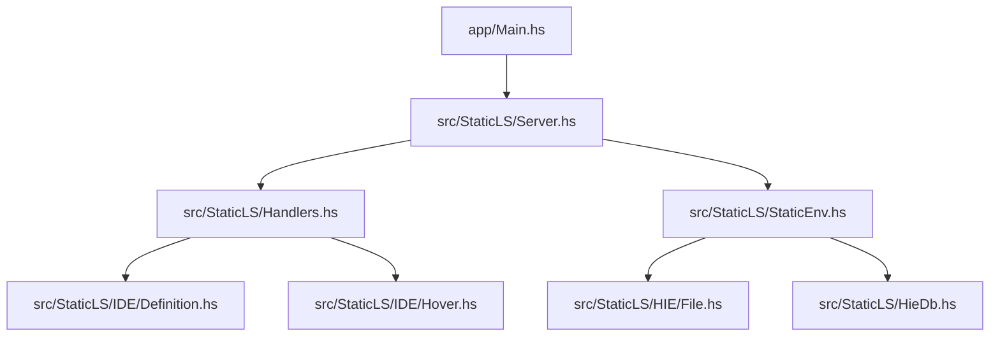

# josephsumabat/static-ls

> Serveur de langage Haskell léger qui lit des fichiers HIE pré-générés, pour gros projets.

## Le problème
haskell-language-server consomme trop de mémoire à la recompilation sur de très gros projets.

## Ce que ça fait vraiment
Main démarre le serveur, qui charge l'environnement statique (fichiers HIE et base hiedb) puis répond aux requêtes LSP : définition, survol, références, renommage, symboles, actions de code, autocomplétion. Il ne génère rien lui-même : l'utilisateur compile avec les bons drapeaux GHC et indexe avec hiedb.

## Comment c'est branché


## Essayer
```bash
cabal install
hiedb -D .hiedb index .hiefiles --src-base-dir .
```

## Coût et pièges
Compilation depuis les sources avec la même version de GHC que le projet (9.4.4 et 9.6.1 supportées explicitement). Il faut réindexer après chaque modification.

## Ce que ce n'est pas
Pas un remplaçant général de haskell-language-server : le README le recommande si la mémoire n'est pas un problème.

## Alternatives
haskell-language-server : préférable hors projets très gros.

## Pour toi
À ignorer : outil d'éditeur pour Haskell, sans rapport avec un profil data/IA/MLOps.

