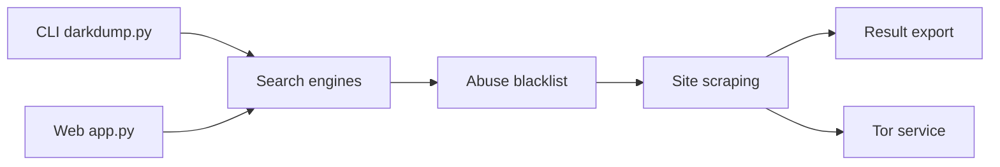

# josh0xA/darkdump

> OSINT tool that queries dark web search engines and extracts emails, metadata and documents.

## The problem
Investigating the dark web requires querying several onion search engines and extracting the clues by hand.

## What it actually does
Six engines (Ahmia by default, notevil, tordex, tor66, onionland, excavator) are queried, the results are filtered against Ahmia's abuse blacklist, then optionally scraped (emails, links, documents, images). A data leak analysis mode, JSON/CSV/TXT exports, a CLI and a local streaming web interface. Tor proxy through the control port.

## How it is wired


## Trying it
```bash
git clone https://github.com/josh0xA/darkdump
cd darkdump
chmod +x install.sh
./install.sh
darkdump-cli -q "privacy tools" -a 10
```

## Cost and gotchas
Free; Tor needs to be configured (`ControlPort 9051`). Four engines do not filter: risk of illegal content; the legal side of usage is your own business.

## What it is not
Not a pentest or protection tool: the author acknowledges the filtering is imperfect. Reserved for legitimate research.

## Alternatives
No alternative named in the README.

## For you
Ignore: specialized OSINT use, outside the data/AI scope, with legal risks on the unfiltered engines.
