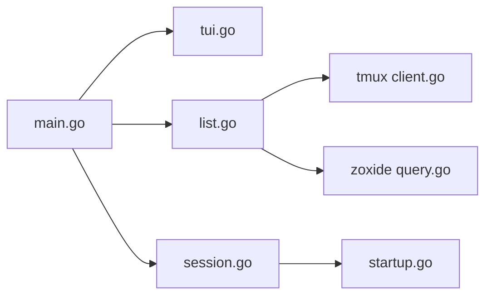

# joshmedeski/sesh

> Go CLI that quickly creates and switches between tmux sessions, relying on zoxide.

## The problem
Navigating between projects in tmux forces you to type long commands and name each session by hand.

## What it actually does
`sesh list` gathers tmux sessions, zoxide directories, configured sessions and tmuxinator; `sesh connect` joins or creates the session, named after the git repository or the folder. `sesh.toml` configuration: startup commands, windows, path wildcards, aliases, previews. Built-in picker or fzf, television, gum. It also handles worktrees linked to GitHub issues/PRs, and provides a skill for coding agents.

## How it is wired


## Trying it
```sh
brew install sesh
sesh list
sesh connect $(sesh list | fzf)
```

## Cost and gotchas
Free. Requires tmux and zoxide installed; `gh` for the GitHub features. The cache is flagged as experimental.

## What it is not
Not a multiplexer: it drives tmux (or a compatible equivalent via `tmux_command`). Support for other multiplexers remains an intention in the README.

## Alternatives
t-smart-tmux-session-manager (the author's previous plugin, cited in the README).

## For you
Adopt if you live in tmux on servers or multiple projects: installation is trivial and the time saved is immediate.
