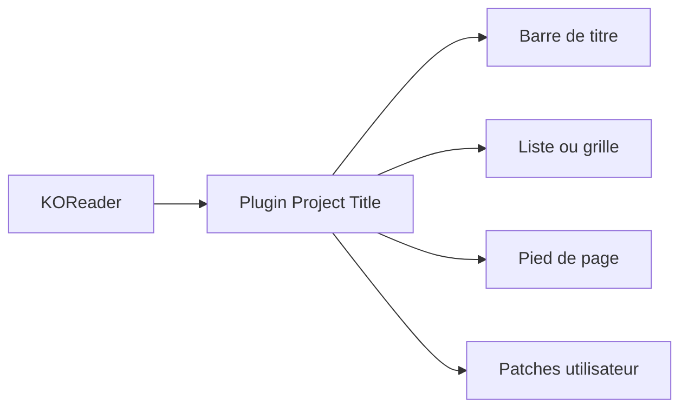

# joshuacant/ProjectTitle

> KOReader plugin that replaces the book browser with a view like a commercial e-reader.

## The problem
Choosing a book in KOReader happens in an unpleasant list of file names.

## What it actually does
- Thinner title bar with Favorites, History, Last book, Parent folder buttons.
- Book list with covers, progress bar proportional to the size of the book.
- Footer with page controls and device status; redesigned book status page.
- Extras: automatic scan after USB ejection, pinch-adjustable sizes, sorting by author or size.
- Derived from the Cover Browser plugin.

## How it is wired

## Trying it
No command documented: the installation guide is in the repository wiki.

## Cost and gotchas
Free. Can slow down old e-readers (grid with folder thumbnails). Assumes well-tagged EPUBs and PDFs (Calibre recommended).

## What it is not
Not for those who want a minimal interface or a phone home screen. AGPL-3.0 license.

## Alternatives
SimpleUI, ZenUI, Bookshelf (other KOReader interface plugins), and Cover Browser from which it derives.

## For you
Ignore: reading comfort on an e-reader, outside the data / AI scope.
