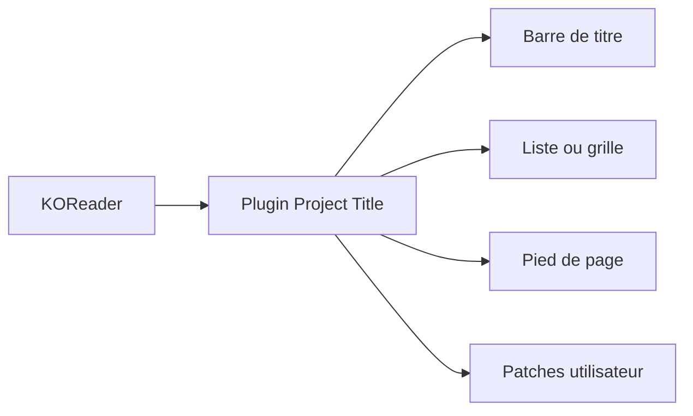

# joshuacant/ProjectTitle

> Plugin KOReader qui remplace l'explorateur de livres par une vue façon liseuse commerciale.

## Le problème
Choisir un livre dans KOReader se fait dans une liste de noms de fichiers peu agréable.

## Ce que ça fait vraiment
- Barre de titre plus fine avec boutons Favoris, Historique, Dernier livre, Dossier parent.
- Liste de livres avec couvertures, barre de progression proportionnelle à la taille du livre.
- Pied de page avec contrôles de pages et état de l'appareil ; page de statut du livre refaite.
- Extras : scan automatique après éjection USB, tailles ajustables par pincement, tri par auteur ou par taille.
- Dérivé du plugin Cover Browser.

## Comment c'est branché

## Essayer
Aucune commande documentée : le guide d'installation est dans le wiki du dépôt.

## Coût et pièges
Gratuit. Peut ralentir les vieilles liseuses (grille avec miniatures de dossiers). Suppose des EPUB et PDF bien renseignés (Calibre conseillé).

## Ce que ce n'est pas
Pas pour qui veut une interface minimale ou un écran d'accueil de téléphone. Licence AGPL-3.0.

## Alternatives
SimpleUI, ZenUI, Bookshelf (autres plugins d'interface KOReader), et Cover Browser dont il dérive.

## Pour toi
À ignorer : confort de lecture sur liseuse, hors périmètre data / IA.

