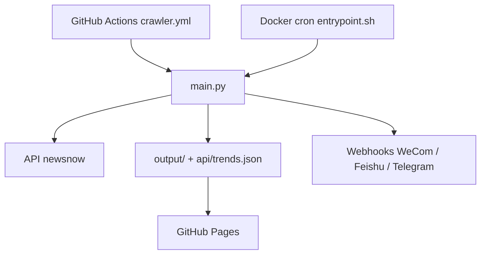

# joyce677/TrendRadar

> Chinese hot-topics aggregator filtered by keywords, published on GitHub Pages or pushed to messaging apps.

## The problem
The news feeds of major platforms drown useful information under algorithmic recommendations.

## What it actually does
A Python script (`main.py`) queries the newsnow API for about ten platforms, filters titles with `frequency_words.txt`, writes HTML, TXT and `api/trends.json`, then sends alerts through webhooks (WeCom, Feishu, DingTalk, Telegram). Three modes: daily, current, incremental. It is a derived version that adds a JSON API.

## How it is wired


## Trying it
```bash
git clone https://github.com/sansan0/TrendRadar.git
cd TrendRadar
cd docker
docker-compose up -d
docker exec -it trend-radar python manage.py status
docker exec -it trend-radar python manage.py run
```

## Cost and gotchas
Free, but depends on the newsnow API and a messaging bot. Webhook URLs go in GitHub Secrets, never in `config.yaml`. README and sources are in Chinese.

## What it is not
Neither an analysis tool nor a model: it only does keyword filtering on Chinese sources.

## Alternatives
The original repository sansan0/TrendRadar and the fork jayzqj/TrendRadar, cited in the README.

## For you
Worth watching: the collect, filter, notify pattern could inspire a personal watch, but sources and documentation are China-oriented, and it is a single-maintainer fork.
