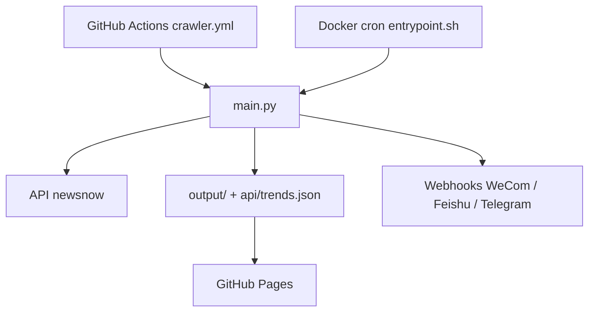

# joyce677/TrendRadar

> Agrégateur chinois de hot topics filtrés par mots-clés, publié sur GitHub Pages ou poussé en messagerie.

## Le problème
Les fils d'actualité des grandes plateformes noient l'information utile sous des recommandations algorithmiques.

## Ce que ça fait vraiment
Un script Python (`main.py`) interroge l'API newsnow pour une dizaine de plateformes, filtre les titres avec `frequency_words.txt`, écrit HTML, TXT et `api/trends.json`, puis envoie les alertes par webhook (WeCom, Feishu, DingTalk, Telegram). Trois modes : daily, current, incremental. C'est une version dérivée qui ajoute une API JSON.

## Comment c'est branché


## Essayer
```bash
git clone https://github.com/sansan0/TrendRadar.git
cd TrendRadar
cd docker
docker-compose up -d
docker exec -it trend-radar python manage.py status
docker exec -it trend-radar python manage.py run
```

## Coût et pièges
Gratuit, mais dépend de l'API newsnow et d'une bot-messagerie. Les URL de webhook se mettent dans les Secrets GitHub, jamais dans `config.yaml`. README et sources en chinois.

## Ce que ce n'est pas
Ni un outil d'analyse ni un modèle : il ne fait que du filtrage par mots-clés sur des sources chinoises.

## Alternatives
Le dépôt d'origine sansan0/TrendRadar et le fork jayzqj/TrendRadar, cités dans le README.

## Pour toi
À surveiller : le schéma collecte, filtre, notification inspire une veille perso, mais sources et documentation sont orientées Chine, et c'est un fork d'un seul mainteneur.

