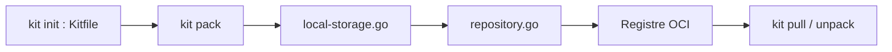

# jozu-ai/kitops

> CLI for packaging and versioning AI/ML projects as OCI artifacts, for MLOps and platform teams.

## The problem
Weights, datasets, code and configs travel separately; it is impossible to version, sign and deploy them as a single unit.

## What it actually does
Packages a project into a ModelKit (or CNCF ModelPack) described by a Kitfile and stored in any OCI registry. Commands `pack`, `push`, `pull`, selective `unpack`, `inspect`, `diff`, `list`, `init`, import from Hugging Face. SHA-256 digests, Cosign signing, integrations with MLflow, GitHub Actions, KServe, Kubeflow, init container. PyKitOps Python SDK.

## How it is wired


## Trying it
```bash
kit init .
kit pack
kit push
kit pull
kit inspect
```

## Cost and gotchas
Free; an existing OCI registry is required. Advanced governance features (policies, scanning) belong to Jozu Hub, a separate product.

## What it is not
Not a model registry nor a training tool: it packages and distributes. It does not replace MLflow, it integrates with it.

## Alternatives
- ModelPack (CNCF): neutral format supported by the same CLI.

## For you
Adopt if you have to ship models to production: OCI, signing and audit fit into an existing CI/CD chain, under CNCF governance.
