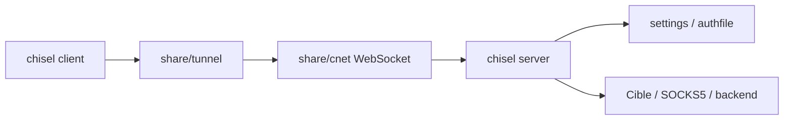

# jpillora/chisel

> TCP/UDP tunnel over HTTP, secured by SSH, in a single executable, to get through firewalls.

## The problem
A service behind a firewall or NAT is unreachable, and opening ports is not always allowed.

## What it actually does
A Go binary that is both client and server: several tunnels over one TCP connection, WebSocket/HTTP transport, SSH encryption, authentication through a users file, server fingerprint, reverse forwarding, SOCKS5 proxy, automatic reconnection with exponential backoff, TLS (including Let's Encrypt) and a `stdio` mode for `ssh ProxyCommand`.

## How it is wired


## Trying it
```bash
docker run --rm -it jpillora/chisel --help
chisel server --port 443 --tls-domain chisel.example.com --auth user:pass
chisel client --auth user:pass https://chisel.example.com R:2222:localhost:22
```

## Cost and gotchas
The authfile patterns are not anchored: anchor them (`^…$`). SOCKS5 now requires a `socks` entry. An `--auth` string without a colon makes startup fail. Some PaaS providers do not accept WebSocket.

## What it is not
Not a full VPN or an anonymity tool. The client does not magically restart a server: `--fingerprint` is "strongly recommended" to prevent interception.

## Alternatives
No alternative named in the README.

## For you
Worth watching: handy for reaching a notebook, a database or a GPU behind a firewall, provided authentication is configured properly.
