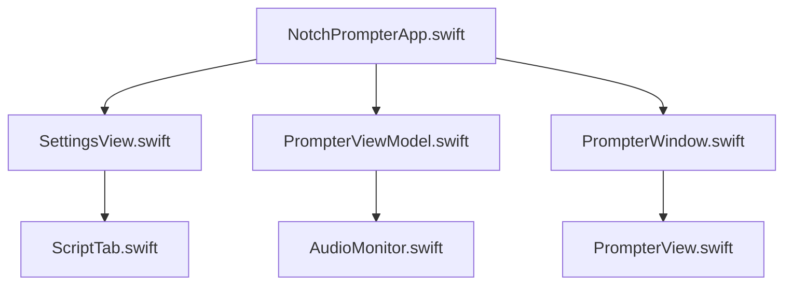

# jpomykala/NotchPrompter

> Floating teleprompter for macOS, always on top, invisible in screen recordings.

## The problem
Reading a text on video or in a meeting forces you to look away from the camera.

## What it actually does
Displays scrolling text in a floating window near the notch. Adjustable speed, size, font and position, multi-screen, several languages, voice activation via the microphone. According to the README, the window does not appear in recording applications. Translations done by DeepL.

## How it is wired


## Trying it
```bash
# Aucune commande documentée dans le README.
```

## Cost and gotchas
macOS only; microphone access for voice. Installation not documented in the README.

## What it is not
Not a transcription or AI tool: it scrolls a text that you write.

## Alternatives
No alternative named in the README.

## For you
macOS presentation gadget unrelated to data / AI: ignore.
