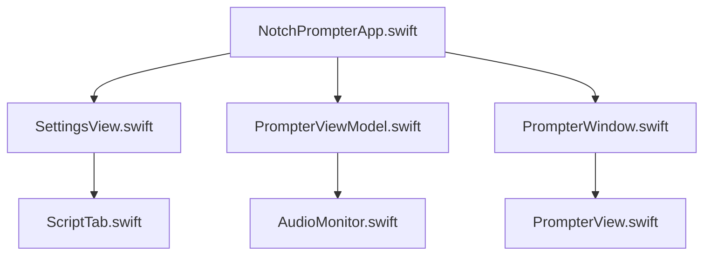

# jpomykala/NotchPrompter

> Téléprompteur flottant pour macOS, toujours au premier plan, invisible dans les enregistrements d'écran.

## Le problème
Lire un texte en vidéo ou en réunion oblige à détourner le regard de la caméra.

## Ce que ça fait vraiment
Affiche un texte défilant dans une fenêtre flottante près de l'encoche. Vitesse, taille, police et position réglables, multi-écrans, plusieurs langues, activation par la voix via le micro. Selon le README, la fenêtre n'apparaît pas dans les applications d'enregistrement. Traductions faites par DeepL.

## Comment c'est branché


## Essayer
```bash
# Aucune commande documentée dans le README.
```

## Coût et pièges
macOS uniquement ; accès au micro pour la voix. Installation non documentée dans le README.

## Ce que ce n'est pas
Pas un outil de transcription ni d'IA : il fait défiler un texte que tu écris.

## Alternatives
Aucune alternative nommée dans le README.

## Pour toi
Gadget macOS de présentation sans lien avec la data / IA : à ignorer.

