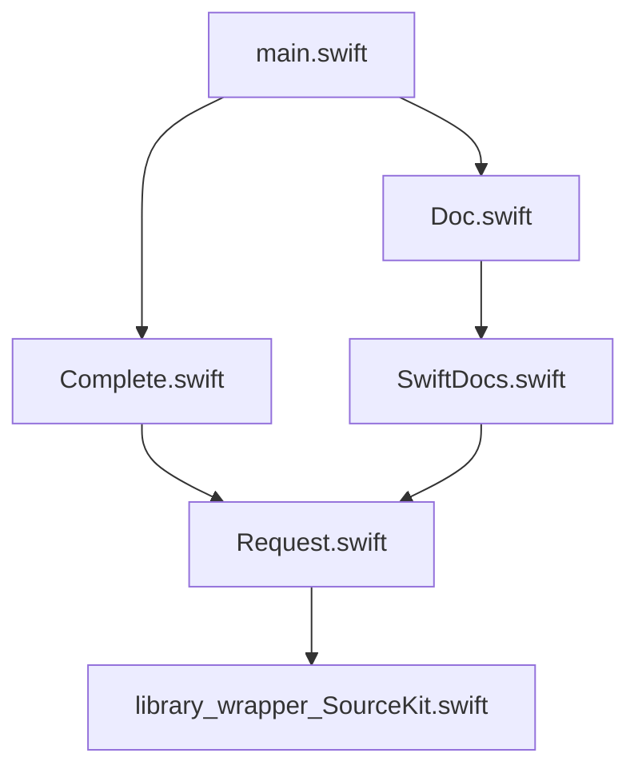

# jpsim/SourceKitten

> Library and command-line tool to query SourceKit: Swift AST, documentation, syntax.

## The problem
Swift tools (linter, doc generator) need simple access to SourceKit.

## What it actually does
Talks to sourcekitd (and libclang), loaded dynamically, to return as JSON the structure, syntax, documents, index, module info and completion options. The sourcekitten command routes to these subcommands. SwiftLint, Jazzy and Sourcery build on it.

## How it is wired


## Trying it
```bash
brew install sourcekitten
swift build
sourcekitten structure --text "struct A { func b() {} }"
```

## Cost and gotchas
Free. Xcode 13.3 or Swift 5.6 to build. On Linux, SourceKit must be at /usr/lib/libsourcekitdInProc.so or set through the LINUX_SOURCEKIT_LIB_PATH variable.

## What it is not
Not a compiler nor a linter: an access layer to SourceKit data. The API is not designed for Objective-C.

## Alternatives
No alternative named in the README.

## For you
Ignore: Swift and Apple ecosystem, unrelated to data or MLOps.
