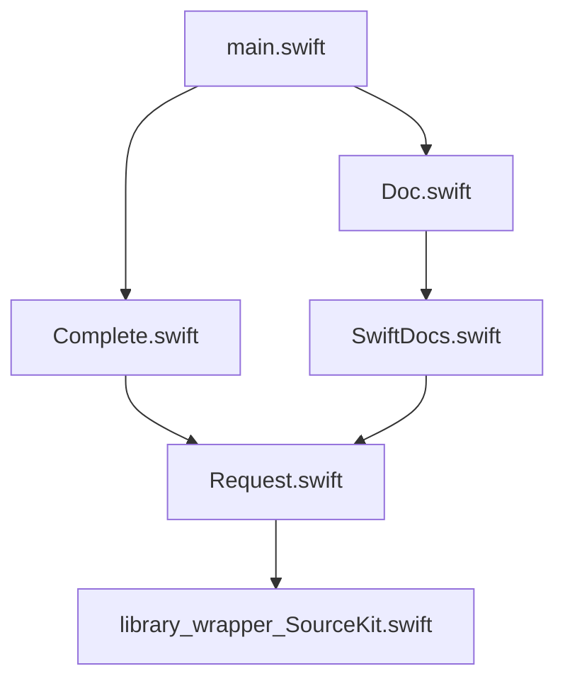

# jpsim/SourceKitten

> Bibliothèque et outil en ligne de commande pour interroger SourceKit : AST Swift, documentation, syntaxe.

## Le problème
Les outils Swift (linter, générateur de doc) ont besoin d'un accès simple à SourceKit.

## Ce que ça fait vraiment
Dialogue avec sourcekitd (et libclang) chargés dynamiquement pour renvoyer en JSON la structure, la syntaxe, les documents, l'index, des infos de module et des options de complétion. La commande sourcekitten route vers ces sous-commandes. SwiftLint, Jazzy et Sourcery s'appuient dessus.

## Comment c'est branché


## Essayer
```bash
brew install sourcekitten
swift build
sourcekitten structure --text "struct A { func b() {} }"
```

## Coût et pièges
Gratuit. Xcode 13.3 ou Swift 5.6 pour compiler. Sous Linux, SourceKit doit se trouver dans /usr/lib/libsourcekitdInProc.so ou la variable LINUX_SOURCEKIT_LIB_PATH.

## Ce que ce n'est pas
Pas un compilateur ni un linter : une couche d'accès aux données de SourceKit. L'API n'est pas conçue pour Objective-C.

## Alternatives
Aucune alternative nommée dans le README.

## Pour toi
À ignorer : écosystème Swift et Apple, sans lien avec la data ou le MLOps.

