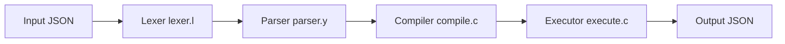

# jqlang/jq

> Command-line JSON processor, like sed or awk but for JSON data.

## The problem
Filtering, transforming and extracting JSON in a shell script without writing a program.

## What it actually does
C binary with no runtime dependency. A jq filter is compiled to bytecode and then run over the JSON stream: JSON parser, language lexer and parser, compiler, executor. Regular expressions through Oniguruma, decimal numbers through DecNumber.

## How it is wired


## Trying it
```bash
docker run --rm -i ghcr.io/jqlang/jq:latest < package.json '.version'
docker run --rm -i -v "$PWD:$PWD" -w "$PWD" ghcr.io/jqlang/jq:latest '.version' package.json
```

## Cost and gotchas
Free. The license is present but not identified by GitHub: to be checked. Building from git: autoreconf and the oniguruma submodule.

## What it is not
Not a tool for large tabular volumes nor a general-purpose programming language. The README points to jqlang.org for the syntax.

## Alternatives
No alternative named in the README.

## For you
Adopt: indispensable for inspecting API responses, JSON logs and configurations in pipelines.
