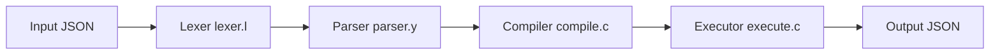

# jqlang/jq

> Processeur JSON en ligne de commande, comme sed ou awk mais pour des données JSON.

## Le problème
Filtrer, transformer et extraire du JSON dans un script shell sans écrire un programme.

## Ce que ça fait vraiment
Binaire en C sans dépendance d'exécution. Un filtre jq est compilé en bytecode puis exécuté sur le flux JSON : analyseur JSON, lexeur et parseur du langage, compilateur, exécuteur. Expressions régulières via Oniguruma, nombres décimaux via DecNumber.

## Comment c'est branché


## Essayer
```bash
docker run --rm -i ghcr.io/jqlang/jq:latest < package.json '.version'
docker run --rm -i -v "$PWD:$PWD" -w "$PWD" ghcr.io/jqlang/jq:latest '.version' package.json
```

## Coût et pièges
Gratuit. La licence est présente mais non identifiée par GitHub : à vérifier. Compilation depuis git : autoreconf et sous-module oniguruma.

## Ce que ce n'est pas
Pas un outil pour de gros volumes tabulaires ni un langage de programmation général. Le README renvoie à jqlang.org pour la syntaxe.

## Alternatives
Aucune alternative nommée dans le README.

## Pour toi
À adopter : incontournable pour inspecter des réponses d'API, des logs JSON et des configurations dans des pipelines.

