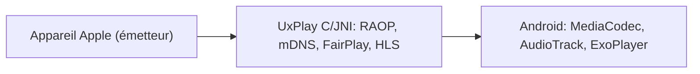

# jqssun/android-airplay-server

> AirPlay receiver for Android and Android TV, based on UxPlay, which turns the device into a screen and speaker.

## The problem
An Android device cannot receive screen mirroring or audio from an iPhone, iPad or Mac.

## What it actually does
It receives screen mirroring (H.264, H.265) and audio (AAC-ELD, AAC-LC, ALAC), plays HLS videos and music with cover art. The protocol part is in C (UxPlay) via JNI; decoding goes through MediaCodec. Settings can also be changed via ADB.

## How it is wired


## Trying it
```bash
git submodule update --init --recursive
./gradlew assembleDebug
```

## Cost and gotchas
Free. DRM-protected content (Apple TV app) is not supported. Devices must be on the same subnet.

## What it is not
Not affiliated with Apple. It is not a data or AI tool, just a media receiver.

## Alternatives
- UxPlay: the implementation of the protocol it derives from.

## For you
Ignore: Android media utility with no use for data, AI or MLOps work.
