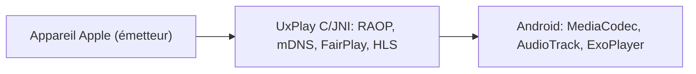

# jqssun/android-airplay-server

> Récepteur AirPlay pour Android et Android TV, basé sur UxPlay, qui transforme l'appareil en écran et enceinte.

## Le problème
Un appareil Android ne peut pas recevoir la recopie d'écran ou l'audio d'un iPhone, iPad ou Mac.

## Ce que ça fait vraiment
Il reçoit la recopie d'écran (H.264, H.265) et l'audio (AAC-ELD, AAC-LC, ALAC), lit les vidéos HLS et la musique avec pochettes. La partie protocole est en C (UxPlay) via JNI ; le décodage passe par MediaCodec. Les réglages se font aussi via ADB.

## Comment c'est branché


## Essayer
```bash
git submodule update --init --recursive
./gradlew assembleDebug
```

## Coût et pièges
Gratuit. Les contenus protégés par DRM (application Apple TV) ne sont pas supportés. Les appareils doivent être sur le même sous-réseau.

## Ce que ce n'est pas
Pas affilié à Apple. Ce n'est pas un outil de data ou d'IA, juste un récepteur multimédia.

## Alternatives
- UxPlay : l'implémentation du protocole dont il dérive.

## Pour toi
Ignorer : utilitaire multimédia Android sans usage pour un travail data, IA ou MLOps.

