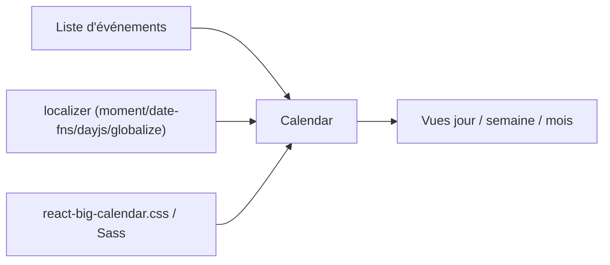

# jquense/react-big-calendar

> React event calendar component, built on flexbox, with a choice of localization.

## The problem
Displaying a calendar (day, week, month) in a React application without writing it from scratch.

## What it actually does
Provides a `Calendar` component that takes a list of events and a `localizer`. Four localizers: Moment.js, Globalize.js, date-fns, Day.js. Styles come from a compiled CSS stylesheet or from customizable Sass files. Starters exist, with drag-and-drop and with TypeScript/Vite.

## How it is wired


## Trying it
```bash
yarn add react-big-calendar
# ou : npm install --save react-big-calendar
git clone git@github.com:bigcalendar/react-big-calendar.git
cd react-big-calendar && yarn && yarn storybook   # localhost:9002
```

## Cost and gotchas
Free. The container must have a height, otherwise the calendar is invisible. Choosing a localizer is mandatory.

## What it is not
Not a full calendar: no storage or synchronization, display only. Not compatible with IE.

## Alternatives
- Full Calendar: source of inspiration cited in the README.

## For you
Ignore: React interface component, useful only if you build a dashboard with a calendar; outside the data/AI core.
