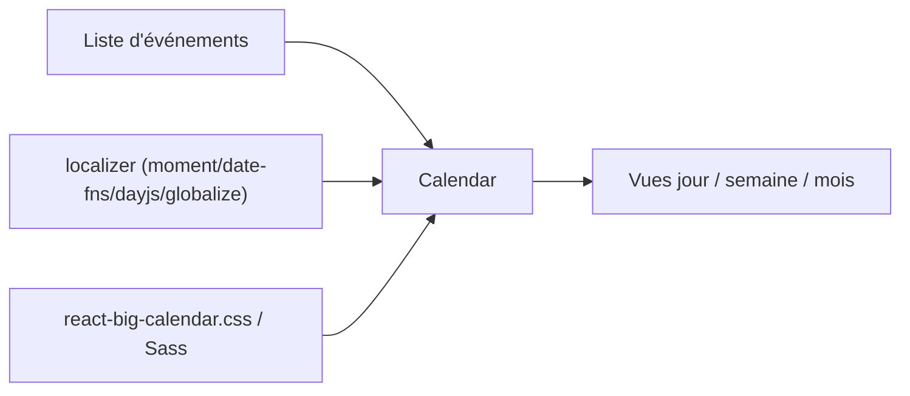

# jquense/react-big-calendar

> Composant React de calendrier d'événements, en flexbox, avec localisation au choix.

## Le problème
Afficher un agenda (jour, semaine, mois) dans une application React sans l'écrire de zéro.

## Ce que ça fait vraiment
Fournit un composant `Calendar` qui reçoit une liste d'événements et un `localizer`. Quatre localiseurs : Moment.js, Globalize.js, date-fns, Day.js. Les styles viennent d'une feuille CSS compilée ou de fichiers Sass personnalisables. Des starters existent, avec glisser-déposer et avec TypeScript/Vite.

## Comment c'est branché


## Essayer
```bash
yarn add react-big-calendar
# ou : npm install --save react-big-calendar
git clone git@github.com:bigcalendar/react-big-calendar.git
cd react-big-calendar && yarn && yarn storybook   # localhost:9002
```

## Coût et pièges
Gratuit. Le conteneur doit avoir une hauteur, sinon le calendrier est invisible. Choisir un localiseur est obligatoire.

## Ce que ce n'est pas
Pas un agenda complet : pas de stockage ni de synchronisation, juste l'affichage. Pas compatible IE.

## Alternatives
- Full Calendar : source d'inspiration citée dans le README.

## Pour toi
Ignorer : composant d'interface React, utile seulement si tu construis un tableau de bord avec agenda ; hors cœur data/IA.

