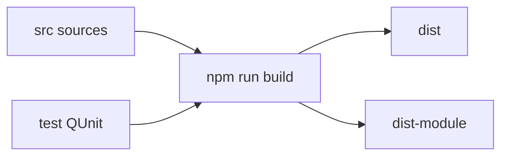

# jquery/jquery

> JavaScript library for manipulating the DOM, events and AJAX requests, aimed at web developers.

## The problem
Writing page-manipulation code compatible with several browsers required a lot of adaptation.

## What it actually does
This README is mostly a contribution guide: building jQuery (`npm run build`), generating variants (slim, ESM module, factory mode), excluding modules (ajax, css, effects, selector…) and running the QUnit test suite with a PHP server. The modules described cover core, selector, manipulation, events, AJAX, CSS and effects.

## How it is wired


## Trying it
```bash
cd jquery
npm install
npm run build
npm run build:all
```

## Cost and gotchas
Free. Unofficial custom builds are not tested regularly (the README says so). Tests: PHP server required.

## What it is not
It is not an application framework; the README does not explain how to use it, only how to build it. Graph components: none readable.

## Alternatives
No alternative named in the README.

## For you
Ignore: web library with no link to data or AI.
