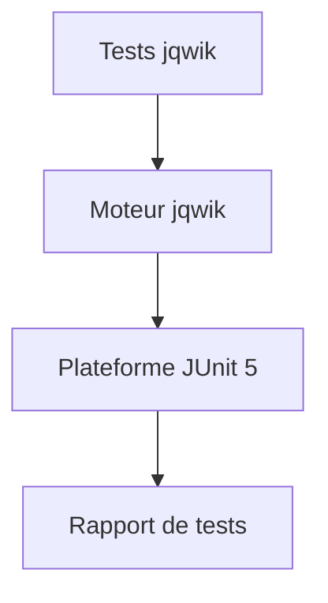

# jqwik-team/jqwik

> Alternative test engine for JUnit 5 focused on property-based testing, for Java developers.

## The problem
Tests with fixed examples miss edge cases that generated inputs would reveal.

## What it actually does
According to the very short README, jqwik plugs into the JUnit 5 platform as a test engine for property tests. Full documentation is on the project website. The project is in maintenance mode: dependency updates and critical bug fixes only.

## How it is wired
Simplified schema based on the sheet, no diagram provided.

## Trying it
No command documented in the README: see the jqwik website.

## Cost and gotchas
Free, under the EPL-2.0 license. Requires Java and JUnit (not listed in the prerequisites). No more feature development without funding.

## What it is not
Not a Python tool: the Python equivalent exists elsewhere. No new features expected.

## Alternatives
No alternative named in the README.

## For you
Ignore: reserved for Java projects and in maintenance only; in Python, look instead at a property-testing tool from that ecosystem.
