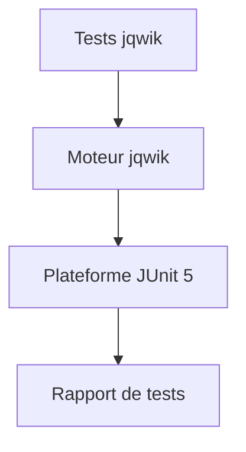

# jqwik-team/jqwik

> Moteur de test alternatif pour JUnit 5 centré sur le test fondé sur les propriétés, pour développeurs Java.

## Le problème
Les tests à exemples fixes manquent des cas limites que des entrées générées révèleraient.

## Ce que ça fait vraiment
D'après le README très court, jqwik s'intègre à la plateforme JUnit 5 comme moteur de test pour les tests de propriétés. La documentation complète est sur le site du projet. Le projet est en mode maintenance : mises à jour des dépendances et corrections de bugs critiques seulement.

## Comment c'est branché
Schéma simplifié d'après la fiche, sans diagramme fourni.

## Essayer
Aucune commande documentée dans le README : voir le site de jqwik.

## Coût et pièges
Gratuit, sous licence EPL-2.0. Nécessite Java et JUnit (non listés dans les prérequis). Plus de développement de fonctions sans financement.

## Ce que ce n'est pas
Pas un outil Python : l'équivalent pour Python existe ailleurs. Pas de nouveautés attendues.

## Alternatives
Aucune alternative nommée dans le README.

## Pour toi
À ignorer : réservé aux projets Java et en maintenance seule ; en Python, regarde plutôt un outil de test de propriétés de cet écosystème.

