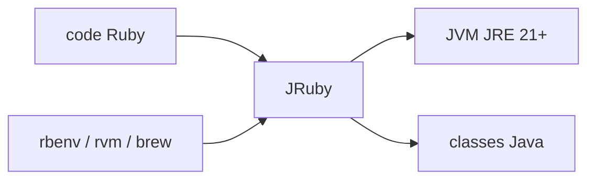

# jruby/jruby

> Implementation of Ruby on the JVM, to run Ruby or embed it in Java applications.

## The problem
Standard Ruby has a global interpreter lock and remains separate from the Java ecosystem. JRuby aims at true parallelism and access to JVM libraries.

## What it actually does
Runs Ruby code on the JVM without a global lock, with integration of Java classes into Ruby and vice versa, and embedding of Ruby as a scripting language in a Java program. Requires a JRE 21 or later.

## How it is wired


## Trying it
```bash
rbenv install jruby
rvm install jruby
brew install jruby
```

## Cost and gotchas
Free. A JRE 21 or later is required. Distribution packages can be very old. License present but not identified by GitHub, to be checked.

## What it is not
Not standard Ruby: the README speaks of complete and correct, but compatibility for native extensions remains to be confirmed (not documented).

## Alternatives
No alternative named in the README.

## For you
Ignore: the Ruby/JVM world is outside your usual data/AI stack, unless you already maintain Ruby.
