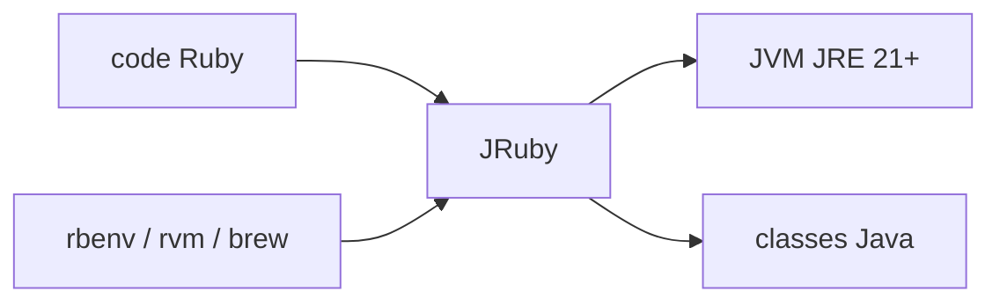

# jruby/jruby

> Implémentation de Ruby sur la JVM, pour exécuter du Ruby ou l'intégrer à des applications Java.

## Le problème
Ruby standard a un verrou global d'interpréteur et reste séparé de l'écosystème Java. JRuby vise la vraie parallélisation et l'accès aux bibliothèques JVM.

## Ce que ça fait vraiment
Exécute du code Ruby sur la JVM sans verrou global, avec intégration des classes Java dans Ruby et inversement, et embarquement de Ruby comme langage de script dans un programme Java. Nécessite un JRE 21 ou plus.

## Comment c'est branché


## Essayer
```bash
rbenv install jruby
rvm install jruby
brew install jruby
```

## Coût et pièges
Gratuit. Un JRE 21 ou plus est requis. Les paquets des distributions peuvent être très anciens. Licence présente mais non identifiée par GitHub, à vérifier.

## Ce que ce n'est pas
Pas Ruby standard : le README parle de complète et correcte, mais compatibilité à confirmer pour les extensions natives (non documenté).

## Alternatives
Aucune alternative nommée dans le README.

## Pour toi
Ignorer : le monde Ruby/JVM est hors de ta pile data/IA habituelle, sauf si tu maintiens déjà du Ruby.

