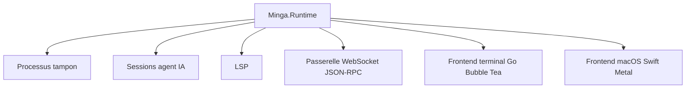

# jsmestad/minga

> Modal text editor written in Elixir on the BEAM, with a built-in AI agent, for Vim users.

## The problem
Current editors were not designed for AI agents that write to files in parallel: the interface lags and editing conflicts are possible.

## What it actually does
Each buffer is an isolated BEAM process. Editing follows Vim modes with `SPC` menus and tree-sitter highlighting. The built-in AI agent supports Anthropic, OpenAI and Google, and shows every change as a diff before writing. Configuration is Elixir code. A headless mode and a JSON-RPC WebSocket gateway exist.

## How it is wired


## Trying it
```bash
git clone https://github.com/jsmestad/minga.git
cd minga
asdf install && mix deps.get && mix compile
bin/minga
```

## Cost and gotchas
Calls to the agent use the API key of the chosen provider, at your expense. You need Elixir via asdf and, for the GUI, macOS. The repository is pre-release, with 271 open issues.

## What it is not
Not a plugin for Vim or Neovim: it is a standalone editor. No license is declared.

## Alternatives
The README mentions Neovim, Emacs and pi as the original editors of the targeted users, without presenting them as alternatives.

## For you
Worth watching: the agent and isolated-buffer architecture is interesting, but a pre-release, single-person project with no license is not something to adopt.
