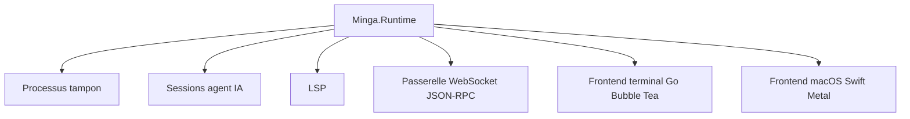

# jsmestad/minga

> Éditeur de texte modal écrit en Elixir sur la BEAM, avec un agent IA intégré, pour utilisateurs de Vim.

## Le problème
Les éditeurs actuels n'ont pas été conçus pour des agents IA qui écrivent dans les fichiers en parallèle : l'interface rame et les conflits d'édition sont possibles.

## Ce que ça fait vraiment
Chaque tampon est un processus BEAM isolé. L'édition suit les modes de Vim avec menus `SPC` et coloration tree-sitter. L'agent IA intégré gère Anthropic, OpenAI et Google, et montre chaque changement en diff avant écriture. La configuration est du code Elixir. Un mode sans interface et une passerelle WebSocket JSON-RPC existent.

## Comment c'est branché


## Essayer
```bash
git clone https://github.com/jsmestad/minga.git
cd minga
asdf install && mix deps.get && mix compile
bin/minga
```

## Coût et pièges
Les appels à l'agent utilisent la clé d'API du fournisseur choisi, à ta charge. Il faut Elixir via asdf et, pour le GUI, macOS. Le dépôt est pré-release, avec 271 issues ouvertes.

## Ce que ce n'est pas
Pas un plugin pour Vim ou Neovim : c'est un éditeur à part. Aucune licence n'est déclarée.

## Alternatives
Le README cite Neovim, Emacs et pi comme éditeurs d'origine des utilisateurs visés, sans les présenter comme alternatives.

## Pour toi
À surveiller : l'architecture agent et tampons isolés est intéressante, mais un projet pré-release d'une seule personne et sans licence ne s'adopte pas.

